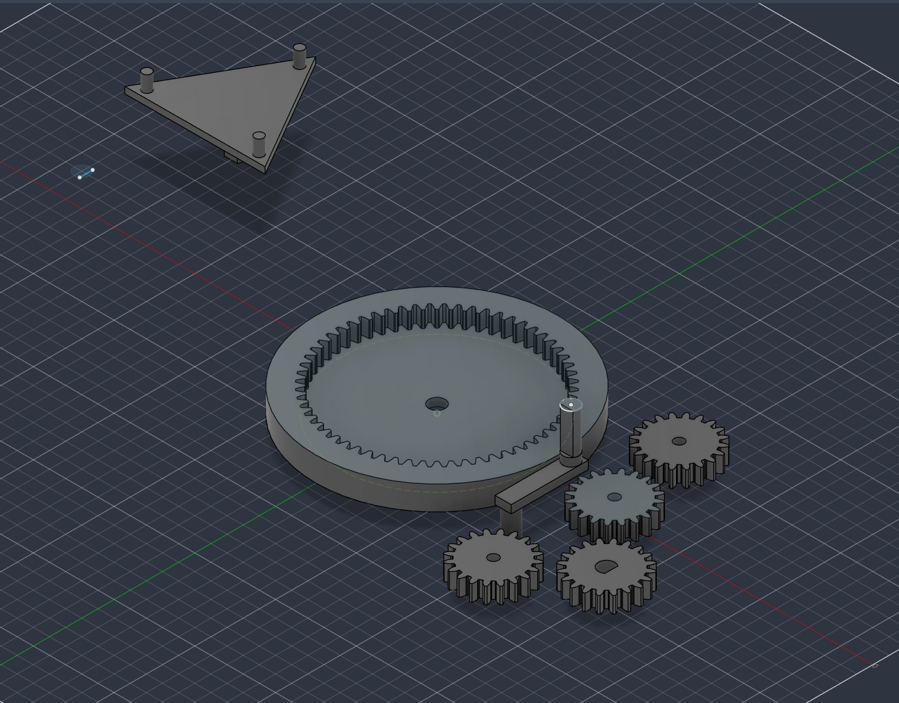
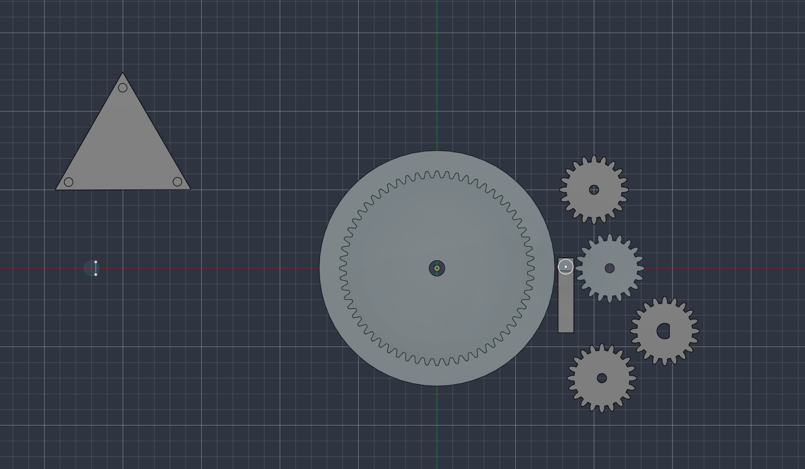
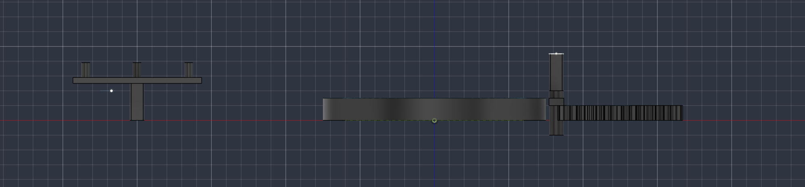

# Stackable Hand-Crank Planetary Gearbox

Fully 3D-printed planetary gearbox you turn by hand. No motor, no bearings, no screws. The only thing I bought was tape.

Made in Fusion 360, printed on a Bambu Lab P1S in PLA.

## What it is

It's a single-stage planetary gear set with a crank on the sun gear. You hold the ring gear still, turn the crank, and the output (the planet carrier) turns slower with more torque. Every shaft just spins in a printed hole with a bit of clearance.

Each module is 4:1. The output of one module plugs into the input of the next, so you can stack them:

- 1 module: 4:1
- 2 modules: 16:1
- 3 modules: 64:1

## How it started

My first plan was a lot bigger: a 2-stage helical gearbox going for 1:36, based on a published design. I was going to remove the motor mount and all the ball bearings and use printed bushings instead. Helical teeth, 20° pressure angle, Module 1.0, with the ring gear teeth cut into the inside of one printed housing and both stages stacked inside it.

## What went wrong

The body I was using to cut the ring gear teeth ended up floating above the housing instead of inside it. They looked close in the browser but weren't touching, so the cut didn't happen. I fixed it by measuring the actual gap in Fusion and moving the body by that exact amount.

Then I closed Fusion without saving and lost a big chunk of work. Instead of rebuilding the same thing, I decided to simplify.

## What I changed

- **One stage instead of two.** Way easier to design, print, and debug, and you can still feel the reduction.
- **Spur teeth instead of helical.** Helical gears are harder to model and more likely to warp on an FDM printer. Spur teeth print clean and mesh fine.
- **No housing.** Each stage is its own module. The carrier output has a D-flat boss that fits a D-flat socket on the next module's sun gear, so modules just push together. The D-flat only fits one way and carries the torque, so no keys or set screws.

## Specs (per module)

| Part | Value |
|---|---|
| Sun gear | 20 teeth |
| Planet gears | 3 × 20 teeth, 120° apart |
| Ring gear | 60 teeth |
| Module | 2.0 |
| Teeth | Spur |
| Input | Sun gear (crank) |
| Output | Planet carrier |
| Held still | Ring gear (by hand) |

Ratio with the ring held: `1 + (60 / 20) = 4:1`. One crank turn gives a quarter turn at the output, with about 4x the torque minus friction.

## Known issue

For 3 planets to be evenly spaced at 120°, (sun teeth + ring teeth) has to be divisible by 3. Mine is 20 + 60 = 80, which isn't. So on paper, the planets can't all mesh perfectly at 120°.

The printed parts still turn smoothly with no binding, so the print clearance is covering the mismatch. If a future version runs rough, this is the first thing I'd fix. Sun 21 / planet 18 / ring 57 or sun 18 / planet 21 / ring 60 would both work.

## What I learned

- **Test early.** The math said my planet spacing was off, but the printed parts turned smoothly anyway. A real test told me more than the numbers alone. The math is still worth doing, though, because it told me where to look if something goes wrong.
- **Precision matters in CAD.** The floating cutter looked fine until I actually measured it. Measure, don't eyeball.
- **Simpler is better for a first version.** Cutting it down to one spur stage got me a working part. The complicated version never got finished.
- **Modular beats fixed.** Making each stage its own module turned out better than the original plan, since I can now pick the ratio by stacking.
- **Save your work.**

## Files

| File | Description |
|---|---|
| `README.md` | this file |
| `01-exploded-module-isometric.png` | isometric view of the parts |
| `03-full-assembly-top-orthographic.png` | top view of the parts |
| `05-module-front-profile.png` | front profile view of the parts |

## Result

Prints clean, assembles by hand, turns smoothly. Modules stack with no extra parts, and each one adds another 4x reduction.
